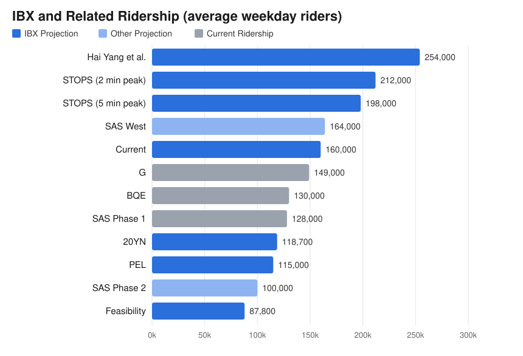

# IBX Ridership Charts

A chart comparing ridership projections for the Interborough Express (IBX)
with projected and current ridership of related lines.



## Data

The numbers are in [`ridership.csv`](ridership.csv),
in average weekday riders.
Each row has a `label`, a `riders_per_day` value, and a `group`,
which sets the bar color:

- `IBX Projection`: IBX ridership projections
  (the feasibility study, PEL, 20YN, STOPS runs, Hai Yang et al., and the current projection).
- `Other Projection`: projections for other lines (SAS Phase 2, SAS West).
- `Current Ridership`: existing lines (G, BQE, SAS Phase 1).

Bars are sorted by ridership, so rows can be in any order.
An optional `year` column gives the year the ridership is for
(the forecast year for projections),
and an optional `source` column links to where each number comes from.

## Sources

Many sources are as cited in ETA's [IBX Automation report](https://kkysen.github.io/eta-publish/reports/ibx-automation/).

| Label | Riders/day | Year | Source |
| --- | ---: | ---: | --- |
| Hai Yang et al. | 254,000 | 2023 | [Hai Yang et al.](https://arxiv.org/abs/2408.01562): upper bound, barring land-use changes, using Replica's 2023 synthetic trips (no future forecast) |
| STOPS (2 min peak) | 212,000 | 2045 | Franklin Tang (NYU Marron) using the FTA's [STOPS](https://www.transit.dot.gov/funding/grant-programs/capital-investments/stops) model, as reported in the [IBX Automation report](https://kkysen.github.io/eta-publish/reports/ibx-automation/) |
| STOPS (5 min peak) | 198,000 | 2045 | Same as above, with the currently stated 5 minute peak headway |
| SAS West | 164,000 | 2045 | [MTA 125th Street Subway Tunnel Draft Scoping Document (October 2026)](https://www.mta.info/document/222046#page=5), p. 4, from the [125th Street Subway Feasibility Study (December 2025)](https://www.mta.info/document/196361#page=13), p. 12: model recalibrated to a post-pandemic 2024 base year |
| Current | 160,000 | 2045 | [Governor Hochul's announcement](https://www.governor.ny.gov/news/governor-hochul-announces-interborough-express-advancing-planning-active-phase#:~:text=ridership%20projections%20to-,160%2C000,-per%20day%2C%20up) of the 2025 design |
| G | 149,000 | 2025 | [NYC subway ridership by line](https://anita.garden/nycriders/): average September 2025 Wednesday |
| BQE | 130,000 |  | [NYC DOT BQE Central](https://www.nyc.gov/html/dot/html/infrastructure/bqecentral.shtml): vehicles/day |
| SAS Phase 1 | 128,000 | 2025 | TODO |
| 20YN | 118,700 | 2045 | [MTA 20-Year Needs Assessment Comparative Evaluation](https://future.mta.info/documents/20-YearNeedsAssessment_ComparativeEvaluation.pdf#page=14), p. 14: model calibrated to 2019 |
| PEL | 115,000 | 2045 | [MTA](https://www.mta.info/document/103691#page=5), from the [PEL study](https://www.mta.info/document/114891#page=15) |
| SAS Phase 2 | 111,500 | 2017 | [FTA Capital Investment Grants profile (FY24)](https://www.transit.dot.gov/sites/fta.dot.gov/files/2023-03/NY-New-York-Second-Avenue-Subway-Phase-2-NSE-Profile-FY24.pdf#page=1), p. 1: current year forecast in daily linked trips; the horizon year (2035) forecast is 123,000, and the MTA cites ~100,000 |
| Feasibility | 87,800 | 2040 | [MTA feasibility study (2022)](https://www.mta.info/document/72081#page=16) (forecast year on [p. 12](https://www.mta.info/document/72081#page=12)) |

## Generating the Charts

[`make_charts.py`](make_charts.py) renders `ridership.csv`
to `ridership.svg` and `ridership.png`.
The PNG is meant for pasting into Google Docs
and isn't committed.

Tools (Python, `uv`, and ImageMagick) are managed by `mise` via [`mise.toml`](mise.toml).
Run either of:

```sh
./make_charts.py
mise run charts
```
